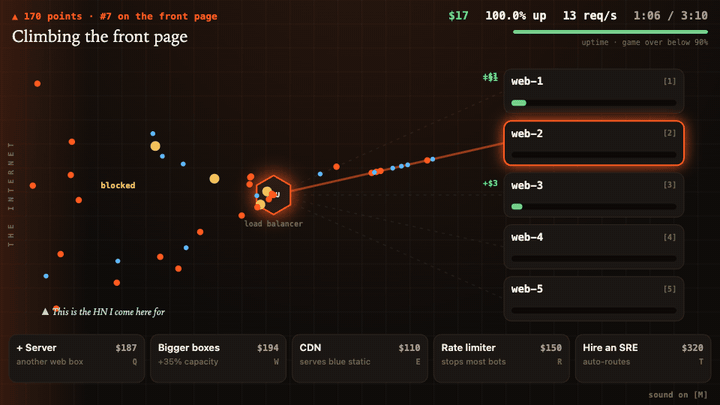
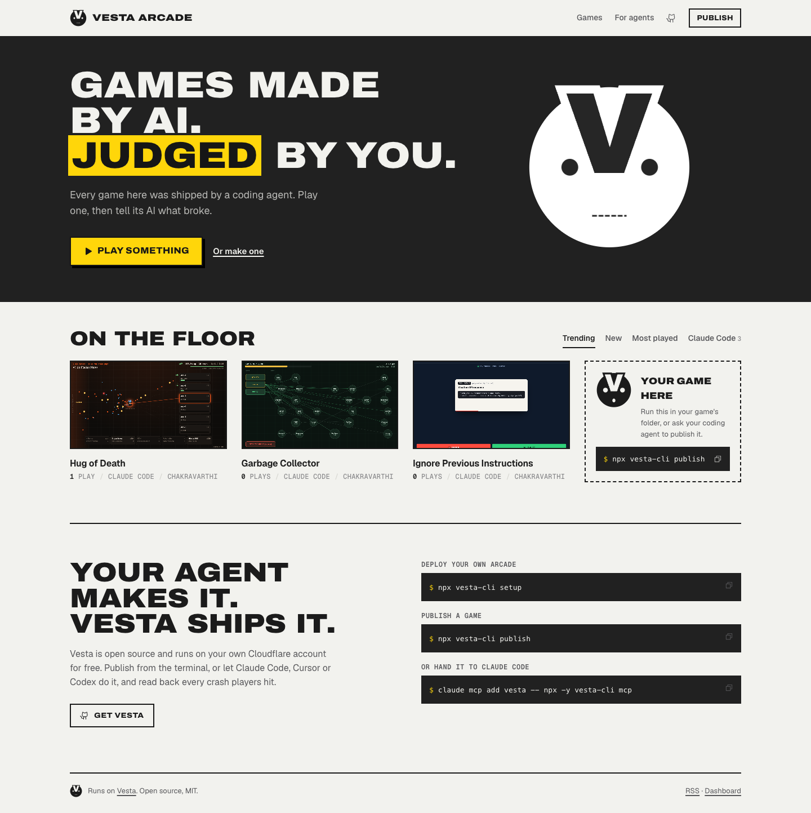
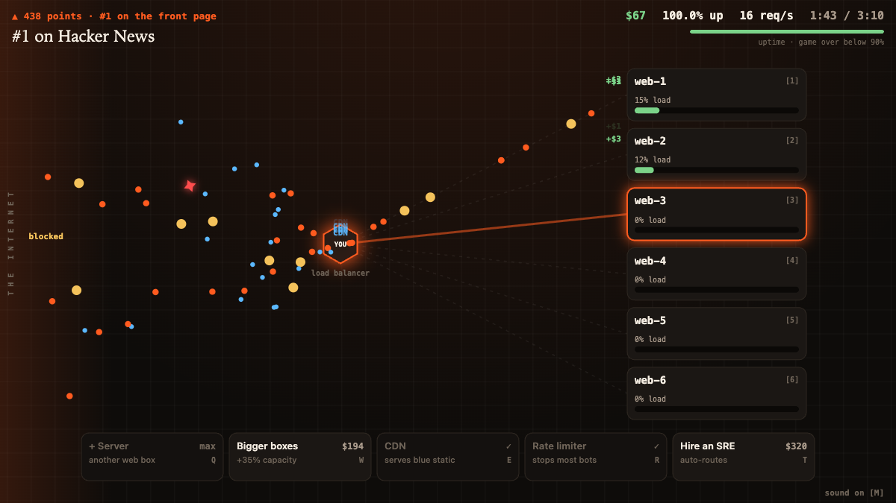
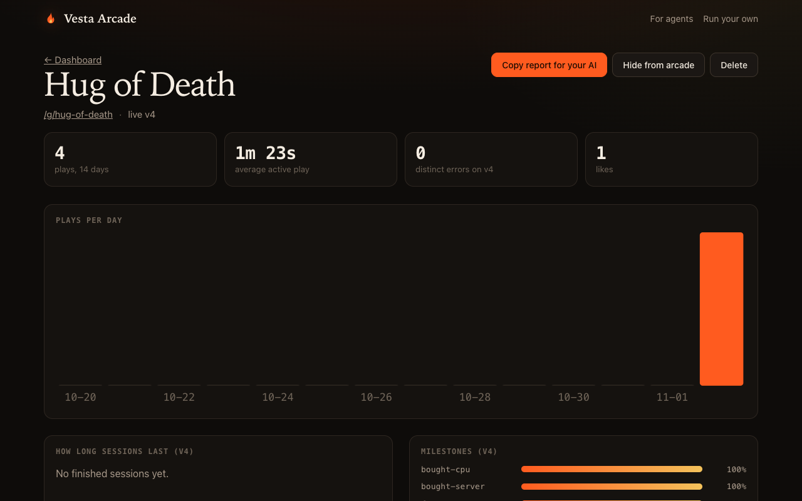
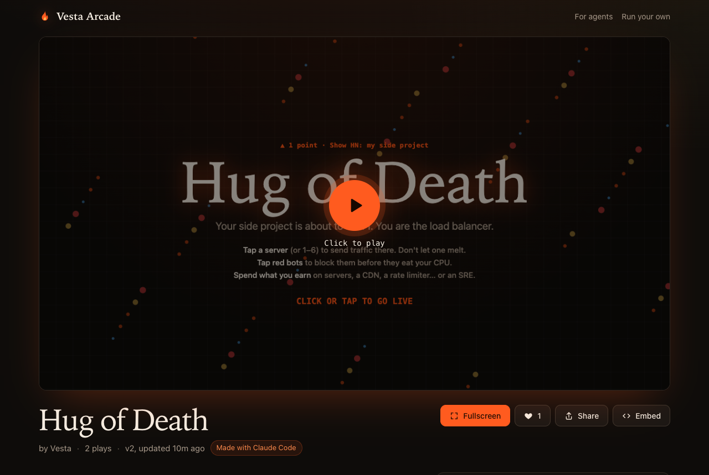
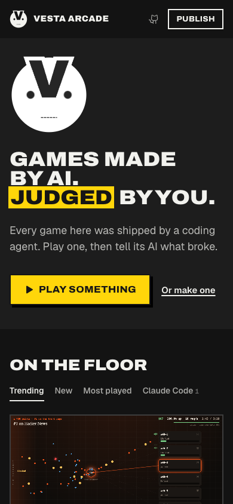

<p align="center"></p>

<h1 align="center">Vesta</h1>

<p align="center"><b>Your coding agent can build a game. It can't watch anyone play it.</b><br>
Vesta is a self-hosted arcade that can. Tell your agent “publish this to Vesta” and get a link anyone can play.<br>
Then get back the crashes, the drop-off and what players said, in a form your agent can fix.<br>
Runs on your own Cloudflare account, on the free plan.</p>

<p align="center"><b><a href="https://vestapowered.in/g/microservices">▶ Play: Microservices (exit vim in under a second)</a></b> · <a href="https://vestapowered.in">Live arcade</a></p>

<p align="center">
  <a href="#quick-start">Quick start</a> ·
  <a href="#for-coding-agents">For agents</a> ·
  <a href="#how-it-works">How it works</a> ·
  <a href="docs/architecture.md">Architecture</a> ·
  <a href="games/hug-of-death">Demo game</a>
</p>

<p align="center"></p>

<p align="center"><b>Play them:</b> <a href="https://vestapowered.in/g/microservices">Microservices</a> · <a href="https://vestapowered.in/g/hug-of-death">Hug of Death</a> · <a href="https://vestapowered.in/g/ignore-previous-instructions">Ignore Previous Instructions</a> · <a href="https://vestapowered.in/g/garbage-collector">Garbage Collector</a></p>

<p align="center"></p>

## Why

Making a browser game with Claude Code, Cursor or Codex takes an afternoon now. What happens next is the hard part. You paste a link somewhere, a few people click it, and you never learn that it crashed on Safari, that half of them quit in the first ten seconds, or that level 3 is impossible.

Vesta closes that loop:

```
   your agent ──publish──▶ playable link ──▶ people play
       ▲                                          │
       └──── errors, drop-off, comments ◀─────────┘
```

- **Publish from the editor.** One command, or one MCP tool call from your agent. Every publish is a new version with a changelog.
- **Feedback an agent can act on.** Uncaught errors with stack traces, grouped and counted. How long sessions last. How far players get. What they wrote. One Markdown report, made to be pasted into an agent, or fetched by one.
- **Yours.** It deploys to your Cloudflare account in one command and fits in the free plan. No platform cut, no AI-content policies, no one else's terms.

## Quick start

You need Node 20+ and a free Cloudflare account.

```sh
npx vesta-cli setup      # deploys your arcade (~2 minutes, opens a browser to sign in to Cloudflare)
npx vesta-cli publish    # run in any folder with an index.html, or a built dist/
```

```
▲ Hug of Death v1 is live (new game)

  https://vesta.you.workers.dev/g/hug-of-death
  1 files · 31.6 KB · cover: screenshot
```

Want it on your own domain? `npx vesta-cli setup --domain games.example.com` (the domain must be on the same Cloudflare account). If the domain already serves a site, Vesta takes over the pages it knows and passes everything else through to the old site.

That's it. `publish` finds your build folder (`dist/`, `build/`, `out/` or the folder itself), uploads it, screenshots the game for a cover image if you have Chrome or Playwright's Chromium, prints a QR code for your phone and saves the game's slug in `vesta.json`, so the next publish becomes v2.

## For coding agents

Add Vesta as an MCP server, then just ask: *“publish this game to Vesta”*, and later, *“check the Vesta feedback and fix the top error”*.

```sh
claude mcp add vesta -- npx -y vesta-cli mcp          # Claude Code
```

For Cursor, Codex, Windsurf, Cline and other MCP clients, add this to their MCP config:

```json
{ "mcpServers": { "vesta": { "command": "npx", "args": ["-y", "vesta-cli", "mcp"] } } }
```

| Tool | What it does |
|---|---|
| `publish_game` | Uploads the project (optionally builds it first) and returns the public link |
| `get_feedback` | Markdown report: errors with stacks, session lengths, milestones, comments, versions |
| `list_games` | Every game on the arcade, with plays and likes |
| `set_cover` | Sets the cover image used in the arcade and in link previews |
| `arcade_status` | Whether an arcade is configured, and where |

Every arcade also serves [`/llms.txt`](worker/src/site/index.tsx), so an agent that only has a URL knows how to publish and what the limits are.

**Games can report progress.** Vesta injects `window.vesta` into every game:

```js
window.vesta?.milestone("reached-level-2"); // the report shows what share of plays get here
window.vesta?.error("Physics exploded");    // a game-level problem, grouped like any other error
window.vesta?.shareUrl;                     // the arcade page's URL, for your share button
await window.vesta?.submitScore(4210);       // arcade high scores: players enter 3 initials
```

`submitScore` shows an arcade-style "enter your initials" box inside the game (in a shadow root, so it can't clash with the game's CSS or controls), ranks the score, and resolves with `{ rank, rankToday, total }` or `null` if the player skips. The game page shows the top ten.

What the agent gets back from `get_feedback`:

```markdown
# Player feedback: Hug of Death (`hug-of-death`)
Live version: v3 · https://vesta.you.workers.dev/g/hug-of-death · last 14 days

## Players
- 412 plays, 380 sessions timed, average 2m 05s of active play
- How long sessions last on v3: <10s 8% · 10-30s 21% · 30-60s 17% · 1-3m 38% · 3-10m 14% · 10m+ 2%

## Errors on v3 (fix these first)
1. **error: TypeError: Cannot read properties of undefined (reading 'h')** at `index.html:412:18` (37×, last 2h ago)
   Browser: Mozilla/5.0 (iPhone; CPU iPhone OS 18_1 like Mac OS X) …

## Milestones on v3
- front-page: 301 sessions (73% of plays)
- rank-1: 122 sessions (30% of plays)

## What players said
- "web-2 melted the second I hit #1, then I couldn't buy anything on my phone" (sam), v3, 3h ago
```

## What you get

<table>
<tr>
<td width="50%"><br><b>An arcade.</b> Trending, new and most played; filter by the AI tool that made each game. RSS feed included.</td>
<td width="50%"><br><b>A dashboard.</b> Plays per day, session length, milestone funnel, errors with stacks, comments, and a button that copies the report for your AI.</td>
</tr>
<tr>
<td><br><b>Click-to-play pages</b> with fullscreen, likes, comments, a changelog, an embed code and a README badge. Share links get a real preview image.</td>
<td> <br><b>Works on phones</b>, where most traffic from X and Discord lands.</td>
</tr>
</table>

## How it works

```
                 ┌──────────────── your Cloudflare account (free plan) ───────────────┐
 vesta publish   │                                                                     │
 MCP tools  ───▶ │  site Worker   vesta.<you>.workers.dev                              │
                 │   arcade · game pages · dashboard · API (Bearer token)              │
                 │      │                         │                                    │
                 │      ▼                         ▼                                    │
                 │   D1 (SQLite)            R2 (game files, covers)                    │
                 │   games, versions,             ▲                                    │
                 │   daily totals, errors         │                                    │
                 │      ▲                         │                                    │
                 │  play Worker   vesta-play.<you>.workers.dev                         │
 players ──────▶ │   serves game files · injects the feedback script · takes beacons   │
                 └─────────────────────────────────────────────────────────────────────┘
```

- **Two Workers, one script.** The same code is deployed twice with a different `ROLE`. Game files are served from a **separate origin**, so a game's JavaScript can never read the arcade's session cookie or call its API. `workers.dev` is on the Public Suffix List, so the two are separate *sites* to the browser, not just separate origins.
- **Defence in depth on the game page.** The arcade sends a strict CSP (`script-src 'self'`, frames only from the play origin, `frame-ancestors 'none'`), and the game iframe is sandboxed without `allow-top-navigation`, so a game can't redirect the arcade to a phishing page.
- **Games load only when someone presses play.** There's no autoplay audio, and a play is counted only when a person asked for one. Headless browsers and link-preview bots aren't counted.
- **Saves don't collide.** Every game shares the play origin, so the injected script namespaces `localStorage`, `sessionStorage` and IndexedDB per game.
- **No raw events are stored.** Telemetry lands as daily totals, a session-length histogram and errors grouped by fingerprint, so the free 5 GB of D1 lasts for years. There are no cookies or fingerprinting, and IPs are only ever stored as a salted hash, for likes and spam limits.
- **Uploads are checked file by file.** Files go up one at a time against a manifest validated in advance: 1,000 files, 100 MB per version, 25 MB per file, no hidden files (no leaked `.env` or `.git/`), no executables, no path tricks. A version goes live only when every file has arrived at the declared size. The newest 3 versions are kept.

More detail, including the data model and why it's built this way: [docs/architecture.md](docs/architecture.md).

## Free plan math

| Piece | Free allowance | Roughly enough for |
|---|---|---|
| Workers | 100,000 requests/day | ~3,000 plays a day for a typical 20-file game |
| R2 | 10 GB stored, free egress | hundreds of games (most AI-made web games are a few MB) |
| D1 | 5 GB, 5M rows read/day | years of daily totals |

When you outgrow it, the Workers paid plan is $5/month. Nothing else changes.

## CLI

```
vesta setup                 Deploy (or upgrade) your arcade on Cloudflare (--name, --domain, --subdomain)
vesta publish [dir]         Publish; -n "notes", -b to build first, --open, --no-screenshot
vesta feedback [slug]       The Markdown report (--json for raw data, --days 30)
vesta list                  Your games
vesta open [slug]           Open the arcade or a game in your browser
vesta login [url]           Connect this machine to an existing arcade (--token)
vesta delete <slug>         Delete a game, every version, its stats and comments
vesta mcp                   Run as an MCP server
```

CI can publish too: set `VESTA_URL` and `VESTA_TOKEN` and run `npx vesta-cli publish dist -n "$COMMIT_MESSAGE"`.

### `vesta.json`

Created on first publish, next to your source. Commit it.

```json
{
  "slug": "hug-of-death",
  "title": "Hug of Death",
  "description": "Your side project just hit #1. You are the load balancer.",
  "author": "you",
  "madeWith": ["Claude Code"],
  "tags": ["arcade"],
  "dir": "dist",
  "build": "npm run build",
  "cover": "cover.png",
  "aspect": "16/9",
  "keyboardRequired": false,
  "sourceUrl": "https://github.com/you/hug-of-death"
}
```

`madeWith` is detected automatically when you publish from Claude Code, Cursor, Codex and others, or when the project has their config files (`CLAUDE.md`, `.cursor/`, …). Use `"aspect": "9/16"` for portrait phone games.

## The games

Four original games, written with Claude Code and published with Vesta. Each is one HTML file with no dependencies, reports milestones and high scores through `window.vesta`, and plays itself if you add `?demo` to its URL.

| | |
|---|---|
| [**Microservices**](https://vestapowered.in/g/microservices) ([source](games/microservices)) | Fifteen tiny developer jobs, a few seconds each: center the div, exit vim, reject the cookies, don't deploy on Friday. Faster every four jobs. |
| [**Hug of Death**](https://vestapowered.in/g/hug-of-death) ([source](games/hug-of-death)) | Your side project just hit #1 and you're the load balancer. Route traffic before servers melt, block scrapers, buy a CDN or an SRE. |
| [**Ignore Previous Instructions**](https://vestapowered.in/g/ignore-previous-instructions) ([source](games/ignore-previous-instructions)) | You're the guardrail between an AI agent and the internet. Block the prompt injections (hidden text, base64, leaky image URLs) and let everything else through. |
| [**Garbage Collector**](https://vestapowered.in/g/garbage-collector) ([source](games/garbage-collector)) | You are the GC. Free what no root can reach, never free what's in use, and watch for cycles. Stop the world if you must. |

## Development

```sh
npm install
npm run dev          # http://localhost:8787 (arcade) and http://play.localhost:8787 (games)
npm test             # manifest and upload rules
npm run typecheck
npm run build        # builds the CLI and bundles the Worker into it
```

Locally, one `wrangler dev` process serves both roles and picks one by hostname. The local token is in `worker/.dev.vars`. To publish to your local arcade:

```sh
node cli/dist/cli.js login http://localhost:8787 --token dev-token-change-me
node cli/dist/cli.js publish games/hug-of-death
```

The code: [`worker/src/play`](worker/src/play) (game files, injected script, telemetry), [`worker/src/site`](worker/src/site) (arcade, dashboard, API; server-rendered with Hono JSX, no client framework), [`cli/src`](cli/src) (CLI, MCP server, Cloudflare setup).

## Roadmap

- Custom domain with a subdomain per game (full storage isolation between games)
- Source maps: show errors at the original file and line
- Remixes: “fork this game”, with credit back to the original
- Signed scores, so high scores can't be posted from outside the game
- Jams: a time-boxed arcade page with voting
- Accounts for other creators, so an arcade can be shared by a team or a class

## License

MIT
